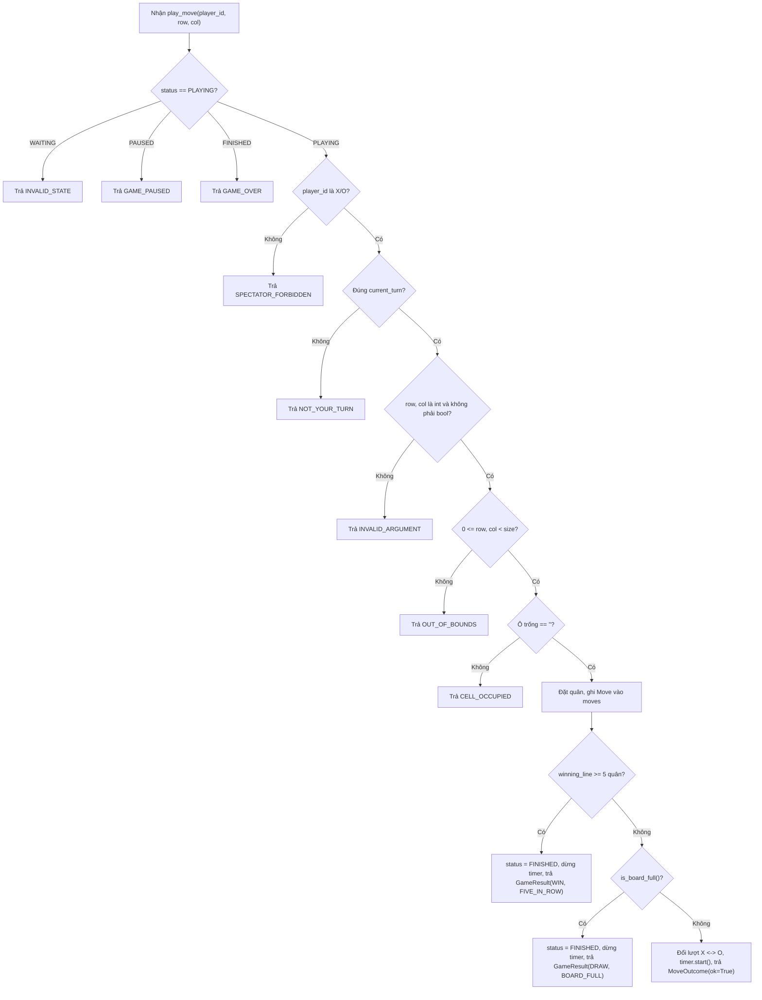

# THIẾT KẾ LUẬT CHƠI & GAME ENGINE (TV4)

**Đề tài:** Game Caro trực tuyến (UDM_16)  
**Thành viên phụ trách:** TV4 — Game Engine  
**Phiên bản:** Đồng bộ theo *Quyết định tích hợp v1.0*  
**Phạm vi mã nguồn:** `Code/Server/Game_Engine/` (`models.py`, `board.py`, `engine.py`, `timer.py`) và kiểm thử tại `Code/Tests/Unit/test_game_engine.py`

---

## 1. Phạm vi và trách nhiệm

TV4 xây dựng bộ máy luật chơi Caro độc lập hoàn toàn với GUI và tầng mạng:
- Quản lý cấu trúc bàn cờ `Board` (`15 × 15`, ô trống `""`, quân `"X"` / `"O"`, chỉ số hàng/cột `0..14`).
- Chuẩn hóa mô hình nước đi (`Move`), trạng thái trận (`GameStatus`), mã kiểm tra nước đi (`MoveCode`, `MoveOutcome`), lý do kết thúc (`EndReason`) và cấu trúc kết quả (`GameResult`).
- Xác thực nước đi hợp lệ (`validate_move`) và thực thi nước đi (`play_move`), quản lý lượt đi (`X` luôn đi trước, đổi lượt `X ↔ O`).
- Kiểm tra thắng (`>= 5` quân liên tiếp theo 4 hướng, chặn hai đầu không làm mất thắng), hòa (`BOARD_FULL` — kiểm tra thắng trước khi kiểm tra đầy bàn), thua (`TIMEOUT`, `RESIGN`, `DISCONNECT`) và hủy không tính thắng/thua (`ABORTED` / `BOTH_DISCONNECTED`).
- Cung cấp đồng hồ lượt (`TurnTimer`) sử dụng `time.monotonic`, hỗ trợ `pause()` / `resume()` giữ nguyên phần thời gian còn lại và làm tròn lên (`math.ceil`) khi gửi `remaining_time` cho client.

---

## 2. Quy tắc luật chơi đã chốt

| Nội dung | Quy tắc triển khai |
| :--- | :--- |
| Kích thước bàn cờ | `15 × 15`; chỉ số `row`, `col` nguyên từ `0` đến `14`; từ chối `bool` |
| Ký hiệu ô | Ô trống: `""`; quân người chơi: `"X"`, `"O"` |
| Lượt đi đầu | `"X"` luôn đi trước ở mỗi ván |
| Điều kiện thắng | Từ **5 quân liên tiếp trở lên** (`>= 5`) theo hàng ngang `(0, 1)`, cột dọc `(1, 0)`, chéo chính `(1, 1)` hoặc chéo phụ `(1, -1)`; bị chặn hai đầu vẫn thắng |
| Điều kiện hòa | Bàn đầy (`225/225` ô đã có quân) và không có nước thắng; luôn kiểm tra thắng trước khi kiểm tra đầy bàn |
| Thời gian lượt | Mặc định `30` giây; cấu hình `int` từ `5` đến `600` giây (`bool` không hợp lệ); dùng `time.monotonic` |
| Tạm dừng / Tiếp tục | Khi `PAUSED`, lưu phần thời gian còn lại; khi `PLAYING` trở lại, tiếp tục phần thời gian còn lại (không cấp lại nguyên lượt) |
| Hết giờ (`TIMEOUT`) | Người đang đến lượt thua, đối thủ thắng |
| Chủ động rời (`RESIGN`) | Người rời khi `PLAYING`/`PAUSED` thua, đối thủ thắng |
| Mất kết nối quá hạn | 1 người quá hạn (`DISCONNECT`): đối thủ thắng; cả 2 offline khi hạn đầu tiên hết (`BOTH_DISCONNECTED`): `outcome="ABORTED"`, `is_draw=False`, `winner_id/loser_id/winner_symbol=None` |

---

## 3. Kiến trúc module & API nội bộ (`Code/Server/Game_Engine/`)

| Tệp | Thành phần chính | Vai trò |
| :--- | :--- | :--- |
| `models.py` | `Symbol`, `GameStatus`, `EndReason`, `MoveCode`, `Move`, `GameResult`, `MoveOutcome` | Kiểu dữ liệu bất biến, `to_dict()` / `from_dict()` và ánh xạ `MoveCode.protocol_code` |
| `board.py` | `Board`, `find_winning_line`, `DEFAULT_BOARD_SIZE`, `EMPTY_CELL` | Khởi tạo bàn cờ `15 × 15`, kiểm tra biên/ô trống, đặt quân, sao chép ma trận độc lập (`to_matrix()`), quét đường thắng 4 hướng |
| `timer.py` | `TurnTimer`, `validate_turn_time_limit` | Đếm ngược `time.monotonic`, `start()`, `stop()`, `pause()`, `resume()`, `remaining()`, `remaining_seconds()` (làm tròn lên), `expired()` |
| `engine.py` | `GameEngine` | Quản lý vòng đời ván (`start`, `pause`, `resume`, `validate_move`, `play_move`, `check_timeout`, `finish`) và hàm thuần `winning_line`, `is_board_full`, `result` |

### Bảng ánh xạ mã lỗi nước đi (`MoveCode` → `ERROR.code`)

| `MoveCode` | `protocol_code` (gửi Client) | Điều kiện kích hoạt |
| :--- | :--- | :--- |
| `GAME_NOT_STARTED` | `INVALID_STATE` | Ván đang ở `WAITING` |
| `GAME_PAUSED` | `GAME_PAUSED` | Ván đang ở `PAUSED` chờ reconnect |
| `GAME_OVER` | `GAME_OVER` | Ván đã ở `FINISHED` |
| `NOT_A_PLAYER` | `SPECTATOR_FORBIDDEN` | Người gửi không phải `X` hoặc `O` |
| `NOT_YOUR_TURN` | `NOT_YOUR_TURN` | Đánh không đúng lượt hiện tại |
| `INVALID_TYPE` | `INVALID_ARGUMENT` | `row`/`col` không phải `int` hoặc là `bool` |
| `OUT_OF_BOUNDS` | `OUT_OF_BOUNDS` | `row`/`col` ngoài `[0, size - 1]` |
| `CELL_OCCUPIED` | `CELL_OCCUPIED` | Ô `(row, col)` đã có quân |

---

## 4. Lưu đồ thuật toán

### 4.1. Lưu đồ kiểm tra & thực hiện nước đi (`GameEngine.play_move`)



### 4.2. Thuật toán kiểm tra thắng 4 hướng (`find_winning_line`)

1. Xác nhận `(row, col)` nằm trong biên bàn cờ và `board[row][col] == symbol`.
2. Duyệt lần lượt 4 trục hướng: dọc `(1, 0)`, ngang `(0, 1)`, chéo chính `(1, 1)`, chéo phụ `(1, -1)`.
3. Với mỗi trục, đếm liên tiếp về phía âm `(-dr, -dc)` và phía dương `(+dr, +dc)` cho đến khi gặp biên hoặc ô khác `symbol`.
4. Ghép `reversed(backward) + [(row, col)] + forward`; nếu `len(line) >= 5` thì trả về `tuple(line)` theo đúng thứ tự liên tiếp (không yêu cầu hai đầu trống).

---

## 5. Cấu trúc kết quả & Ví dụ minh họa (`GameResult`)

### 5.1. Thắng (`WIN` — 5+ quân liên tiếp / hết giờ / đối thủ rời / 1 người quá hạn reconnect)
```json
{
  "outcome": "WIN",
  "is_draw": false,
  "reason": "FIVE_IN_ROW",
  "winner_id": "Alice",
  "loser_id": "Bobby",
  "winner_symbol": "X",
  "winning_line": [[7, 2], [7, 3], [7, 4], [7, 5], [7, 6]],
  "total_moves": 9
}
```
*(Với `TIMEOUT`, `RESIGN`, `DISCONNECT`: `winning_line` là `[]`.)*

### 5.2. Hòa (`DRAW` — Bàn cờ đầy 225 ô không có đường thắng)
```json
{
  "outcome": "DRAW",
  "is_draw": true,
  "reason": "BOARD_FULL",
  "winner_id": null,
  "loser_id": null,
  "winner_symbol": null,
  "winning_line": [],
  "total_moves": 225
}
```

### 5.3. Hủy trận không tính thắng/thua (`ABORTED` — Cả hai offline khi hết hạn reconnect đầu tiên)
```json
{
  "outcome": "ABORTED",
  "is_draw": false,
  "reason": "BOTH_DISCONNECTED",
  "winner_id": null,
  "loser_id": null,
  "winner_symbol": null,
  "winning_line": [],
  "total_moves": 12
}
```

---

## 6. Kiểm thử & Bàn giao

- **Unit test (`Code/Tests/Unit/test_game_engine.py`):** Kiểm tra `Board` `15 × 15` và sao chép độc lập, lượt đi đầu `X` và đổi lượt, đầy đủ mã lỗi validate (T02), thắng 4 hướng + `>= 6` quân + chặn hai đầu + ưu tiên thắng trước hòa trên ô cuối (T20), bàn đầy hòa, `TurnTimer` (`pause`/`resume` giữ phần còn lại, làm tròn lên `math.ceil`, validate `5..600`), `GameResult` cho `ABORTED`/`BOTH_DISCONNECTED` và `Move.from_dict`/`to_dict`.
- **Integration test (`Code/Tests/Integration/test_server_application.py`, `test_synchronization.py`):** Kiểm tra phối hợp TV4–TV5–TV3 qua `ServerApplication` và `SyncManager` cho các tình huống T02, T11 (`ABORTED` + dọn phòng), T17 (timeout sát nước đi), và giữ nguyên thời gian lượt khi `PAUSED`/`RESUMED`.
- **Giới hạn đã ghi nhận:** Giao diện Client (`Code/Client/GUI/app.py`) hiện hiển thị chuỗi đơn giản từ `winner` nên việc định dạng riêng thông báo `ABORTED` và tô sáng `winning_line` thuộc phạm vi hoàn thiện hiển thị của TV6. Các bài test mở socket TCP thật cần chạy ngoài môi trường sandbox chặn kết nối loopback.
