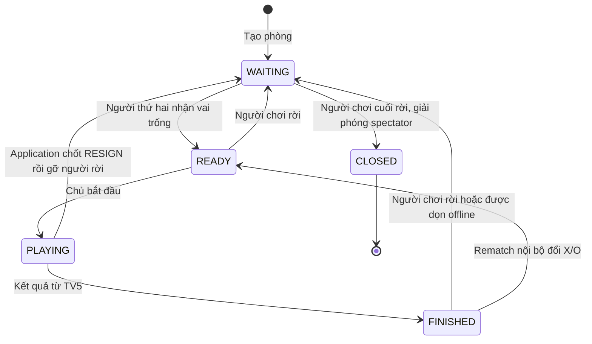
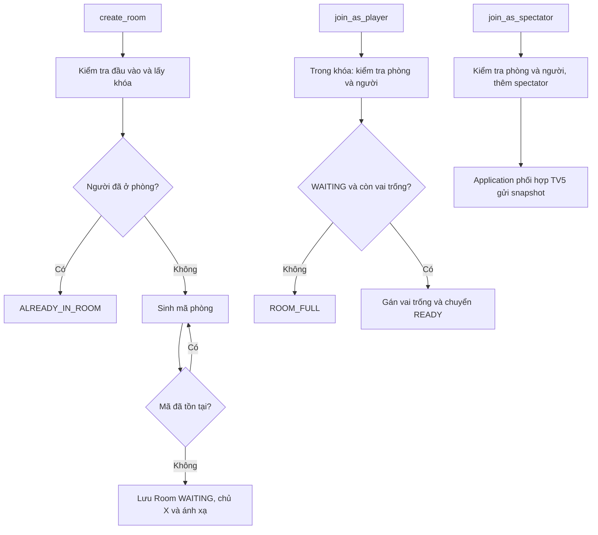
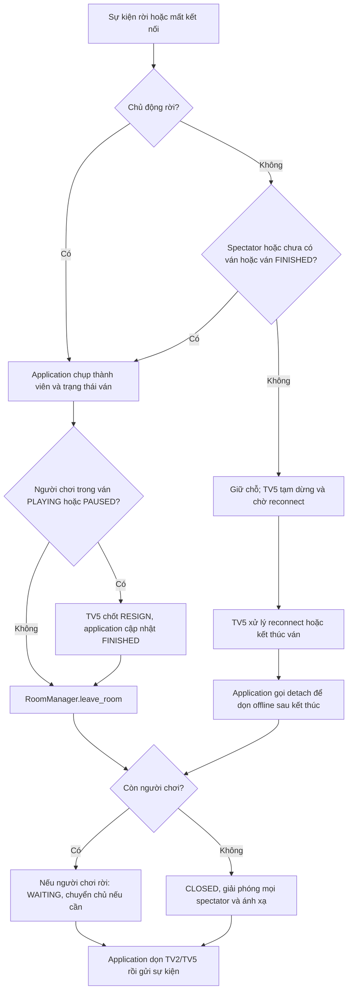
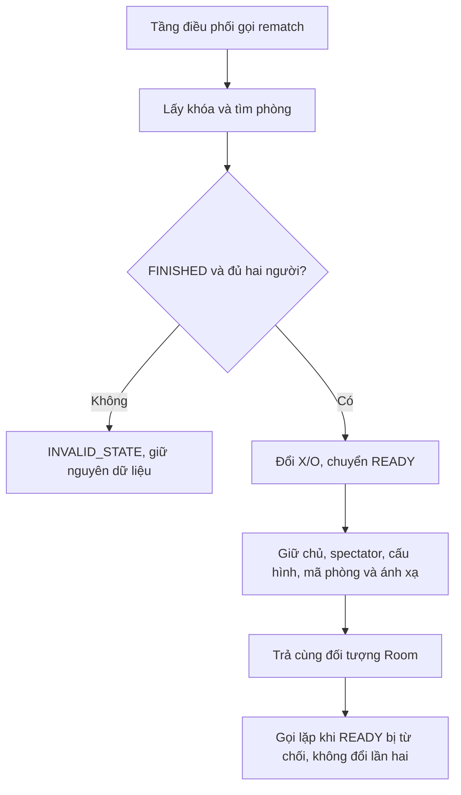

# Room & Match — hiện trạng module TV3

Cập nhật: 12/11/2026. Tài liệu mô tả mã nguồn hiện tại; phân biệt API nội bộ với chức năng đã tích hợp.

## 1. Phạm vi và trách nhiệm

TV3 quản lý Room, RoomManager, RoomStatus, Role, chủ phòng, X/O, spectator và ánh xạ người–phòng tại `Code/Server/Room_Match/`.

TV3 chủ trì luồng tạo/vào/rời/đóng phòng, rematch và chuyển trạng thái phòng trong tầng application; không sở hữu toàn bộ application.py. TV1 quản lý mạng/protocol; TV2 danh tính/PlayerStatus; TV4 luật/kết quả; TV5 GameState/timer/snapshot/reconnect/lịch sử; TV6 GUI. Quyết định tích hợp 1.0 là mục tiêu tham chiếu, không phải bằng chứng nghiệm thu hoặc xác nhận đồng thuận cả nhóm.

## 2. Quy tắc hiện hành

- Mỗi người chỉ thuộc một phòng, kể cả spectator hoặc người đang giữ chỗ reconnect.
- Mỗi phòng tối đa hai người chơi; spectator không chiếm X/O và không tự trở thành chủ.
- Tạo phòng: chủ cầm X, trạng thái WAITING. time_limit là số nguyên 5–600 giây, không nhận bool.
- Mã phòng là 6 ký tự hex viết hoa. Sinh mã, kiểm tra trùng, sinh lại nếu cần và lưu phòng trong cùng khóa RLock để không ghi đè phòng cũ.
- Vào chơi chỉ khi WAITING và còn vai trống. Người mới nhận X hoặc O còn trống; không đổi quân của người đang ở phòng. Đủ hai người chuyển READY.
- Chỉ chủ phòng được bắt đầu khi READY. Chủ có thể cầm O sau chuyển chủ hoặc rematch.
- Spectator được đăng ký vào phòng tồn tại; không đổi trạng thái phòng. Snapshot do tầng tích hợp phối hợp TV5 cung cấp.
- Chủ động rời ván PLAYING/PAUSED: application yêu cầu TV5 chốt RESIGN rồi gỡ thành viên. Còn người chơi thì WAITING và chuyển chủ nếu cần; hết người chơi thì CLOSED, xóa phòng và giải phóng spectator.
- Mất kết nối khi đang đấu: giữ chỗ trong RoomManager; TV5 chuyển GameState sang PAUSED và quản lý hạn reconnect. RoomStatus vẫn PLAYING. Spectator, người chưa có ván hoặc người có ván FINISHED được application dọn ngay.
- detach_disconnected_player() chỉ gỡ người chơi khi phòng FINISHED/WAITING; bên gọi xác nhận offline và hết quyền giữ chỗ. Hàm không tự quyết định kết quả hay tạo RESIGN thứ hai.
- rematch() nội bộ yêu cầu FINISHED và đủ hai người; đổi X/O, chuyển READY. Giữ room_id, host, name, spectator, time_limit, created_at và ánh xạ. Gọi lại khi READY bị từ chối. Hàm không thu thập đồng ý hai bên hoặc tạo GameState mới.

## 3. Trạng thái phòng

| Trạng thái | Ý nghĩa |
|---|---|
| WAITING | Một người chơi; có thể có spectator |
| READY | Hai người chơi, chưa bắt đầu ván |
| PLAYING | GameState PLAYING hoặc PAUSED; giữ chỗ reconnect |
| FINISHED | Ván kết thúc, chờ thao tác tiếp theo hoặc dọn offline |
| CLOSED | Không còn người chơi; đã xóa khỏi danh sách phòng |



## 4. API nội bộ

| API | Hành vi |
|---|---|
| create_room(host, name, time_limit) | Tạo phòng, chống trùng mã |
| join_as_player(room_id, username) | Nhận vai trống, đủ người thì READY |
| join_as_spectator(room_id, username) | Thêm spectator và ánh xạ thành viên |
| leave_room(username) | Gỡ thành viên và trả thông tin thay đổi |
| detach_disconnected_player(username) | Gỡ người offline sau kết thúc theo điều kiện bên gọi |
| start_match(room_id, requester) | Kiểm tra chủ và READY, chuyển PLAYING |
| finish_match(room_id) | PLAYING → FINISHED |
| rematch(room_id) | FINISHED đủ hai người → đổi quân, READY |
| list_rooms(only_playing=False) | Summary phòng; lọc PLAYING bao gồm ván PAUSED |
| validate_move_permission(username, room_id) | Chặn người ngoài, spectator hoặc phòng chưa PLAYING; TV5 kiểm tra tiếp trạng thái trận và lượt |

Thông tin rời/detach gồm room_id, role, match_aborted, room_closed, winner, remaining_members, removed_members. Các danh sách là bản chụp độc lập; khi đóng phòng, removed_members gồm cả spectator. match_aborted là trường tương thích nội bộ, không phải kết quả ABORTED của GameResult.

Room.to_summary() gồm room_id/name/host/status/players/spectator_count; to_dict() thêm spectators/time_limit. Chưa có match_id/match_status trong payload phòng; cần ghép dữ liệu TV5 ở tầng tích hợp.

## 5. Sơ đồ hoạt động

### Tạo và vào phòng



### Rời phòng và reconnect



### Rematch nội bộ



Sơ đồ rematch mô tả API nội bộ, không khẳng định quy trình chấp thuận hai bên qua mạng đã có.

## 6. Tích hợp đã có và còn thiếu

Đã nối CREATE_ROOM, JOIN_ROOM, JOIN_AS_SPECTATOR, LIST_ROOMS, START_MATCH, LEAVE_ROOM qua ServerApplication. Rời/đóng phòng đã phối hợp TV2/TV5 để chốt kết quả một lần và dọn thành viên; xem [room_match_integration.md](room_match_integration.md).

Còn thiếu hoặc cần phối hợp:

- REMATCH/REMATCH_RESPONSE, hai bên đồng ý, hạn 30 giây và hủy yêu cầu khi rời/disconnect.
- Snapshot cho spectator vào PAUSED/FINISHED; thứ tự ROOM_JOINED/ROOM_STARTED trước snapshot.
- Phát ROOM_LIST sau mọi thay đổi; metadata trận trong payload phòng.
- Chặn INVITE_PENDING tại lệnh tạo/vào phòng, phối hợp TV2.
- TV6 xử lý ROOM_CLOSED, xác nhận rời phòng và sửa màn hình phòng.
- Giữ thời gian reconnect và BOTH_DISCONNECTED/ABORTED do TV5/TV4 chủ trì; TV3 hỗ trợ dọn thành viên.

## 7. Kiểm chứng

Test module: Code/Tests/Unit/test_room_match.py. Test tích hợp: Code/Tests/Integration/test_server_application.py; dùng callback mạng giả và lịch sử trong thư mục tạm.

```powershell
python -m unittest Code.Tests.Unit.test_room_match Code.Tests.Integration.test_server_application -v
```

Test trùng mã ép nhiều lần trùng phần UUID rút gọn, xác nhận phòng cũ không mất dữ liệu. Test rematch kiểm tra bảo toàn dữ liệu và ánh xạ, phòng khác không đổi, chủ cầm O vẫn bắt đầu được, gọi lặp/sai trạng thái không sửa dữ liệu.

Lần kiểm tra ngày 12/11/2026: sáu module unittest theo README, 70/70 test đạt. Đây là kiểm chứng mã tại workspace, không thay thế nghiệm thu GUI hoặc rematch hai bên đồng ý. Sơ đồ Mermaid chưa được xác minh bằng trình render; minh chứng GUI và demo nhiều phòng vẫn cần bổ sung cùng nhóm.
