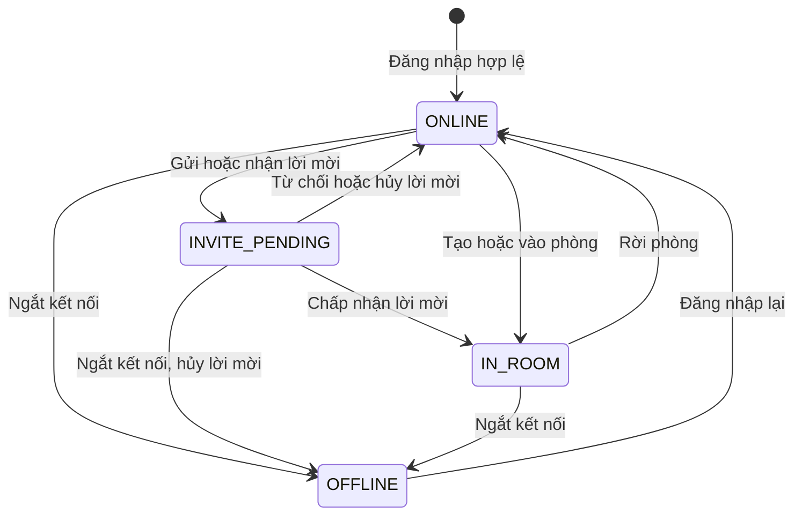
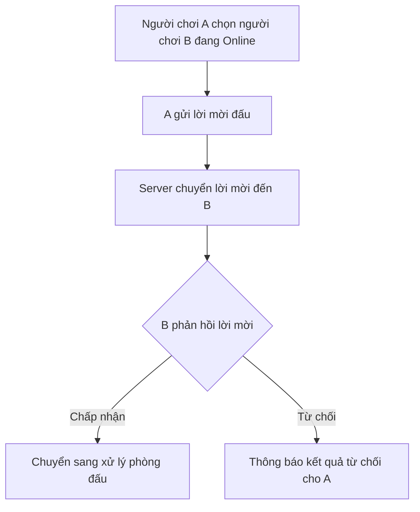
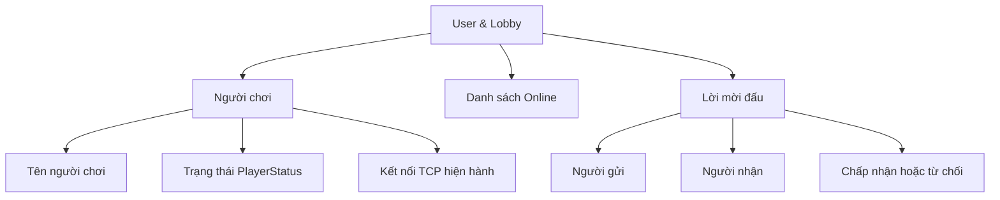
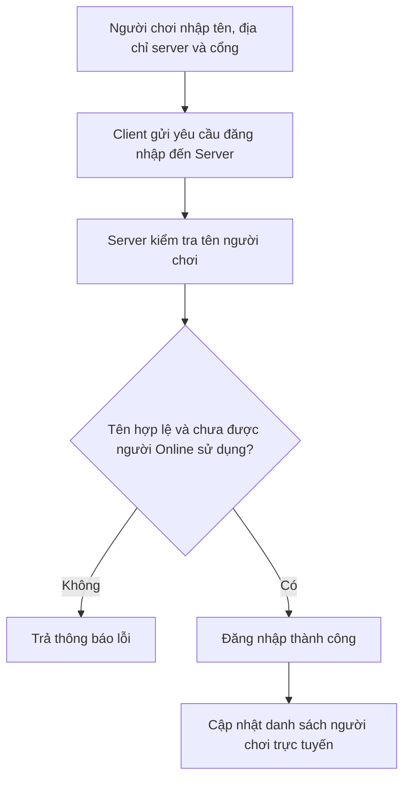
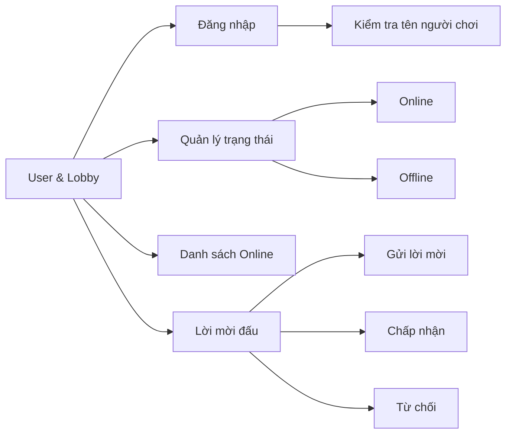

# Phân tích và thiết kế chức năng User & Lobby

## 1. Mục tiêu

User & Lobby quản lý các chức năng liên quan đến người chơi trước khi vào phòng đấu, gồm:

- Đăng nhập.
- Quản lý trạng thái Online/Offline.
- Hiển thị danh sách người chơi trực tuyến.
- Gửi, chấp nhận và từ chối lời mời đấu.

Người chơi kết nối đến server, đăng nhập bằng tên, xem danh sách người trực tuyến và gửi lời mời đấu. Server quản lý trạng thái người chơi.

## 2. Đăng nhập

Người chơi nhập tên để đăng nhập. Client cho phép nhập tên người chơi, địa chỉ server và cổng kết nối.

Server kiểm tra tên người chơi trước khi chấp nhận đăng nhập.

| Trường hợp | Kết quả |
|---|---|
| Tên hợp lệ và chưa được người đang Online sử dụng | Đăng nhập thành công và chuyển sang trạng thái Online. |
| Tên không đúng quy tắc | Trả thông báo lỗi. |
| Tên đang được người Online sử dụng | Trả thông báo lỗi. |

## 3. Quy tắc tên người chơi

Tên người chơi phải đáp ứng các điều kiện sau:

- Có từ 3 đến 20 ký tự.
- Bắt đầu và kết thúc bằng chữ cái hoặc chữ số.
- Chỉ chứa chữ cái, chữ số, dấu gạch dưới `_` hoặc dấu gạch nối `-`.
- Không trùng với tên của người chơi đang Online.

## 4. Danh sách người chơi trực tuyến

Hệ thống cung cấp danh sách người chơi đang Online.

Danh sách này được dùng để:

- Hiển thị người chơi đang có mặt trong hệ thống.
- Cho phép người chơi chọn đối tượng để gửi lời mời đấu.

Khi người chơi đăng nhập thành công, danh sách Online được cập nhật. Khi người chơi không còn ở trạng thái trực tuyến, danh sách cũng được cập nhật tương ứng.

## 5. Trạng thái người chơi

Trạng thái nội bộ của người chơi:

| Trạng thái | Ý nghĩa |
|---|---|
| `ONLINE` | Đã đăng nhập và đang ở sảnh, có thể nhận lời mời hoặc vào phòng. |
| `INVITE_PENDING` | Đang có lời mời chờ phản hồi; chưa thể tạo hoặc vào phòng khác. |
| `IN_ROOM` | Đang ở trong phòng với vai trò người chơi hoặc spectator. |
| `OFFLINE` | Không còn kết nối hiện hành; có thể đăng nhập lại bằng cùng tên. |



## 6. Lời mời đấu

Người chơi có thể gửi lời mời đấu đến một người chơi đang Online.

Người nhận lời mời có hai lựa chọn:

- **Chấp nhận:** chuyển sang xử lý phòng đấu.
- **Từ chối:** hệ thống thông báo kết quả từ chối cho người gửi.



## 7. Dữ liệu cần quản lý

### Player

| Trường | Kiểu | Mục đích |
|---|---|---|
| `name` | chuỗi | Tên hiển thị; dài 3–20 ký tự, không phân biệt hoa thường khi kiểm tra trùng. |
| `connection` | kết nối hoặc `None` | Kết nối TCP hiện tại; `None` khi offline. |
| `status` | `PlayerStatus` | Một trong `ONLINE`, `INVITE_PENDING`, `IN_ROOM`, `OFFLINE`. |

Server không lưu mật khẩu; đăng nhập hiện nhận diện người chơi bằng tên hợp lệ
trên kết nối TCP.

### Invitation

| Trường | Kiểu | Mục đích |
|---|---|---|
| `invite_id` | chuỗi | Mã duy nhất để liên kết phản hồi với lời mời đang chờ. |
| `sender_key`, `recipient_key` | chuỗi chuẩn hóa | Khóa tên không phân biệt hoa thường để tìm đúng người chơi. |
| `sender_name`, `recipient_name` | chuỗi | Tên hiển thị gửi trong thông điệp và dùng khi chuyển sang luồng tạo trận. |

Danh sách online được tạo từ những Player có `connection` khác `None`; danh
sách lời mời chờ do InvitationManager quản lý trong thời gian server chạy.



## 8. Luồng đăng nhập



## 9. Sơ đồ chức năng



## 10. Hợp đồng tích hợp với Network và Room

ServerApplication là điểm nối giữa dịch vụ User & Lobby, giao thức TCP và
RoomManager. Các thông điệp lobby dùng chung JSON newline-delimited với phần
Network:

| Chức năng | Client gửi | Server trả/phát |
|---|---|---|
| Đăng nhập | `LOGIN` (`name`) | `LOGIN_RESULT` hoặc `ERROR`, sau đó phát `PLAYER_LIST` |
| Làm mới danh sách | `PLAYER_LIST` | `PLAYER_LIST` (`players`) |
| Mời đấu | `INVITE` (`target`) | Người nhận nhận `INVITE`; hai bên nhận `INVITE_RESULT` |
| Phản hồi lời mời | `INVITE_RESPONSE` (`invite_id`, `accepted`) | `INVITE_RESULT`; chấp nhận sẽ chuyển tiếp sang luồng tạo trận |
| Tạo phòng | `CREATE_ROOM` (`name`, `time_limit`) | `ROOM_CREATED` có người tạo giữ vai X |
| Vào phòng | `JOIN_ROOM` (`room_id`) | `ROOM_JOINED` có người vào nhận vai còn trống (thường là O) |

Trạng thái người chơi được cập nhật theo luồng tích hợp: `ONLINE` khi đăng
nhập thành công, `INVITE_PENDING` trong khi chờ lời mời, `IN_ROOM` sau khi tạo
hoặc vào phòng, và `OFFLINE` khi ngắt kết nối. Khi rời phòng, trạng thái được
trả về `ONLINE` nếu kết nối còn hoạt động. Tên người chơi được so sánh không
phân biệt hoa thường để ngăn đăng nhập trùng tên.

Khi đang `INVITE_PENDING`, người chơi không thể đồng thời tạo hoặc vào phòng;
Server trả `ERROR` với mã `INVALID_STATE`. Nếu lời mời bị từ chối hoặc hủy,
trạng thái được phục hồi để người chơi tiếp tục thao tác trong lobby.

Kiểm thử TV2:

```powershell
python -m unittest Code.Tests.Unit.test_user_lobby Code.Tests.Integration.test_user_lobby_tcp -v
```