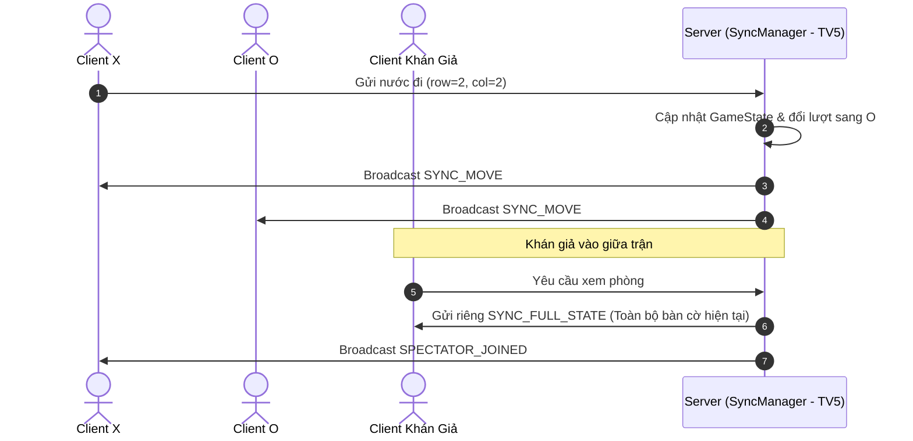
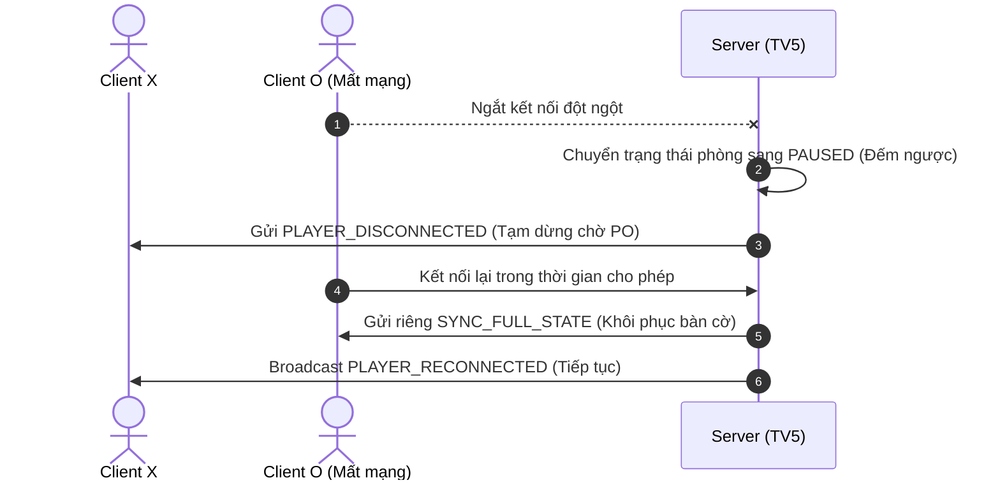

# TÀI LIỆU THIẾT KẾ ĐỒNG BỘ HÓA (TV5 - SYNCHRONIZATION)

## 1. Mô hình trạng thái trận đấu (`GameState`)
- `room_id`: Mã phòng đấu.
- `status`: Trạng thái trận (`WAITING`, `PLAYING`, `PAUSED`, `FINISHED`).
- `players`: Dictionary lưu tên người chơi `{"X": player_x, "O": player_o}`.
- `spectators`: Tập hợp (`set`) lưu danh sách khán giả đang xem phòng.
- `board`: Ma trận 2 chiều `15x15` lưu trạng thái quân cờ (`""`, `"X"`, `"O"`).

## 2. Sơ đồ luồng đồng bộ nước đi và Khán giả

## 3. Luồng xử lý Mất kết nối và Kết nối lại (Reconnect)
