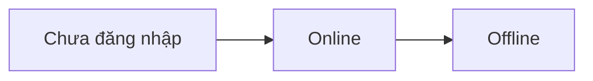
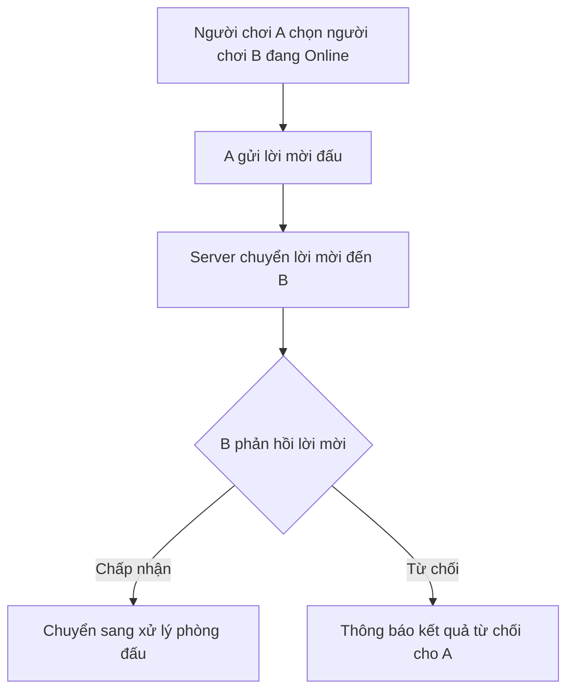
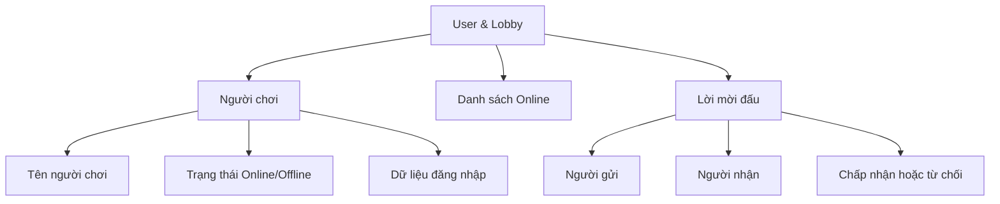
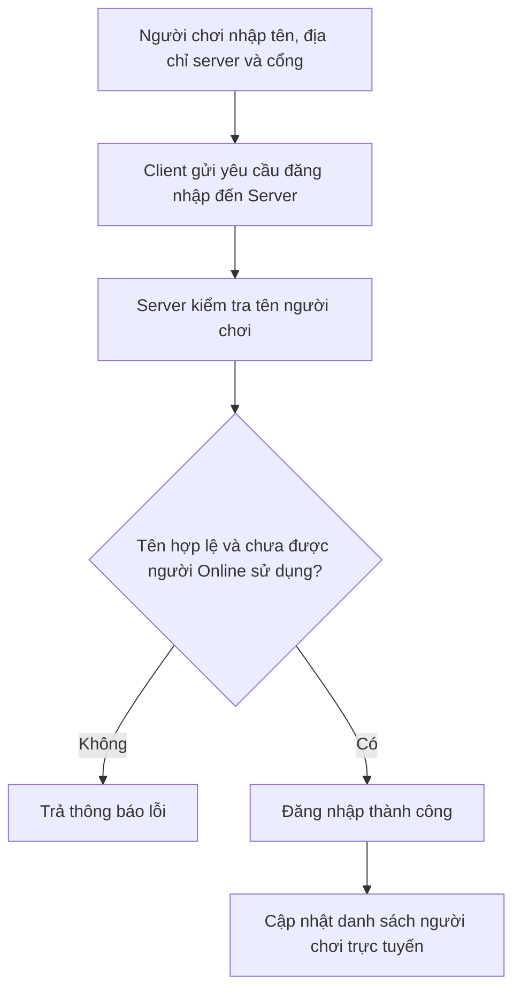
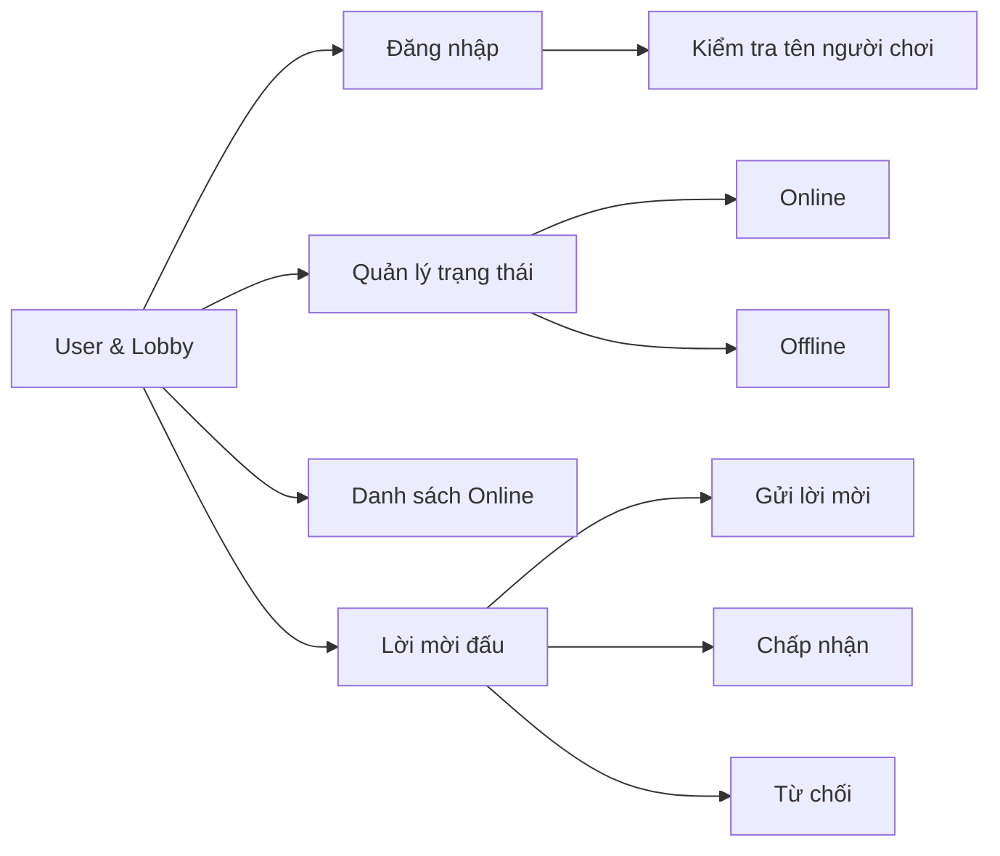

# Phân tích và thiết kế chức năng User & Lobby

## 1. Mục tiêu

User & Lobby quản lý các chức năng liên quan đến người chơi trước khi vào phòng đấu, gồm:

- Đăng nhập.
- Quản lý trạng thái Online/Offline.
- Hiển thị danh sách người chơi trực tuyến.
- Gửi, chấp nhận và từ chối lời mời đấu.

Người chơi kết nối đến server, đăng nhập bằng tên, xem danh sách người trực tuyến và gửi lời mời đấu. Server quản lý trạng thái người chơi.

## 2. Đăng nhập

Người chơi nhập tên để đăng nhập. Client cho phép nhập tên người chơi, địa chỉ server và cổng kết nối.

Server kiểm tra tên người chơi trước khi chấp nhận đăng nhập.

| Trường hợp | Kết quả |
|---|---|
| Tên hợp lệ và chưa được người đang Online sử dụng | Đăng nhập thành công và chuyển sang trạng thái Online. |
| Tên không đúng quy tắc | Trả thông báo lỗi. |
| Tên đang được người Online sử dụng | Trả thông báo lỗi. |

## 3. Quy tắc tên người chơi

Tên người chơi phải đáp ứng các điều kiện sau:

- Có từ 3 đến 20 ký tự.
- Bắt đầu và kết thúc bằng chữ cái hoặc chữ số.
- Chỉ chứa chữ cái, chữ số, dấu gạch dưới `_` hoặc dấu gạch nối `-`.
- Không trùng với tên của người chơi đang Online.

## 4. Danh sách người chơi trực tuyến

Hệ thống cung cấp danh sách người chơi đang Online.

Danh sách này được dùng để:

- Hiển thị người chơi đang có mặt trong hệ thống.
- Cho phép người chơi chọn đối tượng để gửi lời mời đấu.

Khi người chơi đăng nhập thành công, danh sách Online được cập nhật. Khi người chơi không còn ở trạng thái trực tuyến, danh sách cũng được cập nhật tương ứng.

## 5. Trạng thái người chơi

Người chơi có hai trạng thái:

| Trạng thái | Ý nghĩa |
|---|---|
| Online | Người chơi đã kết nối và đăng nhập thành công vào server. |
| Offline | Người chơi không còn ở trạng thái trực tuyến. |

## 6. Lời mời đấu

Người chơi có thể gửi lời mời đấu đến một người chơi đang Online.

Người nhận lời mời có hai lựa chọn:

- **Chấp nhận:** chuyển sang xử lý phòng đấu.
- **Từ chối:** hệ thống thông báo kết quả từ chối cho người gửi.

## 7. Dữ liệu cần quản lý

| Dữ liệu | Mục đích |
|---|---|
| Tên người chơi | Nhận diện và hiển thị người chơi. |
| Trạng thái Online/Offline | Xác định người chơi có đang trực tuyến hay không. |
| Dữ liệu đăng nhập | Phục vụ quá trình đăng nhập. |
| Thông tin lời mời | Xác định người gửi, người nhận và phản hồi lời mời. |
| Danh sách Online | Cung cấp danh sách người chơi trực tuyến cho Client. |

## 8. Luồng đăng nhập

## 9. Sơ đồ chức năng

