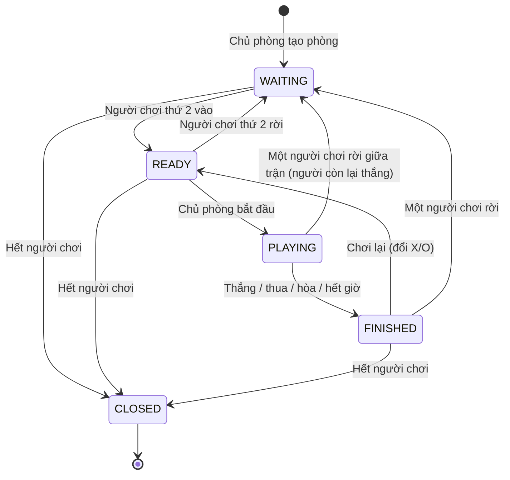
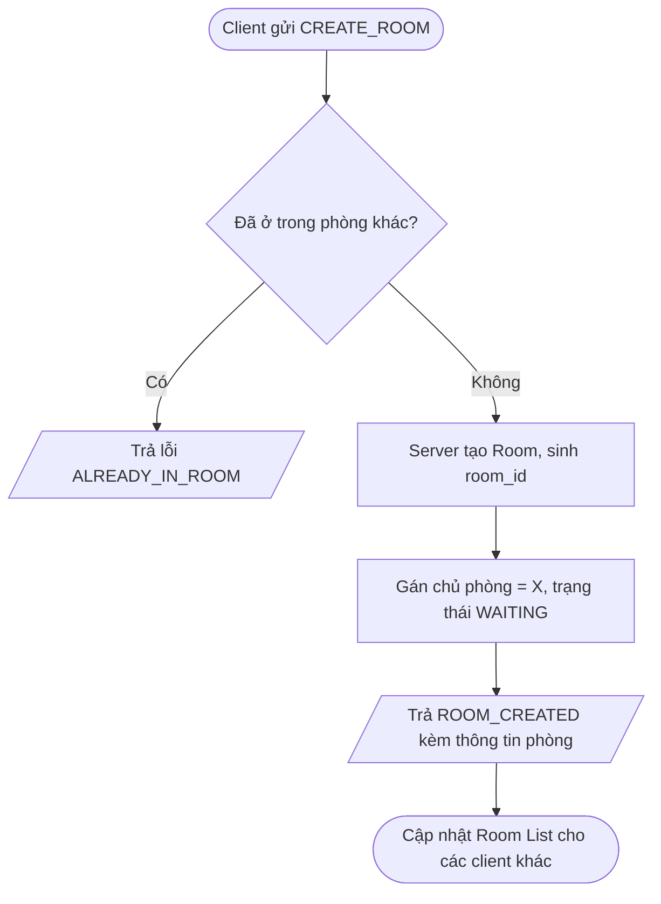
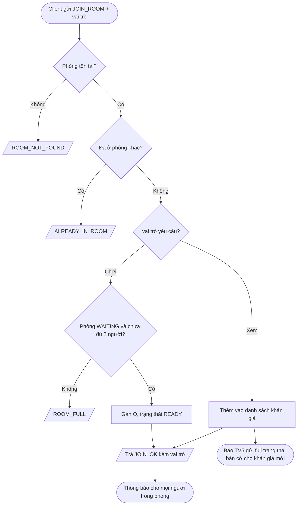
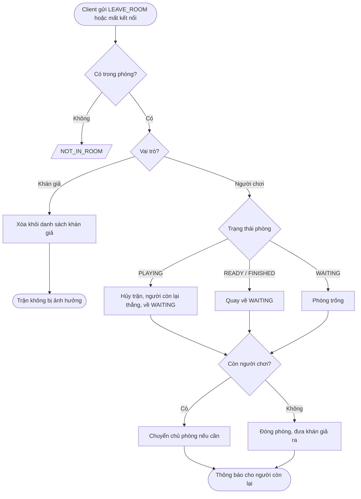
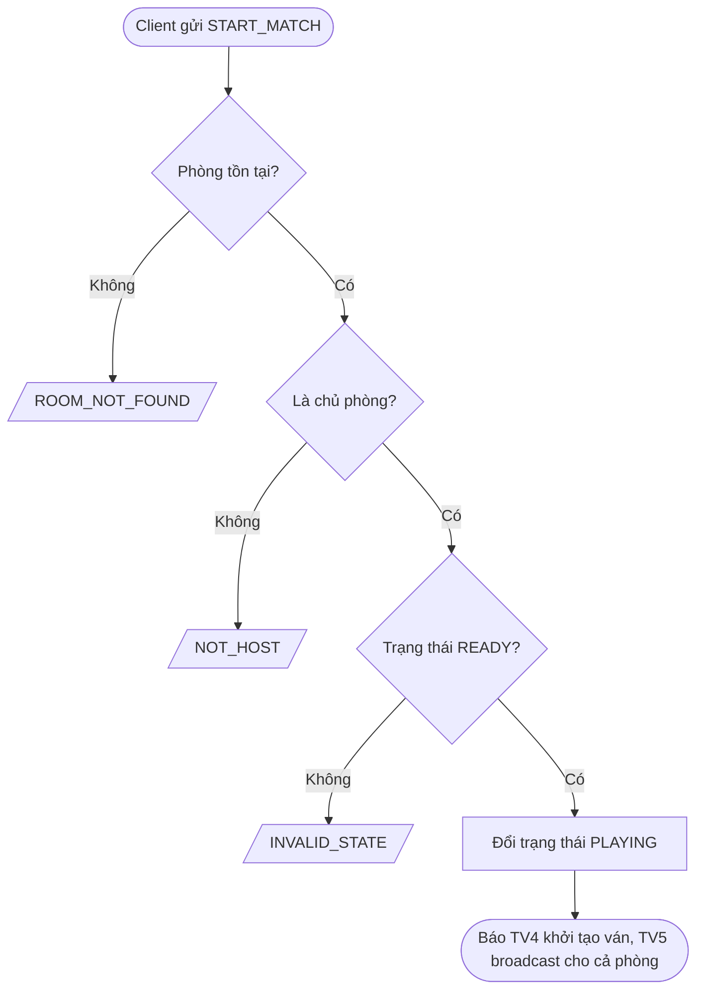
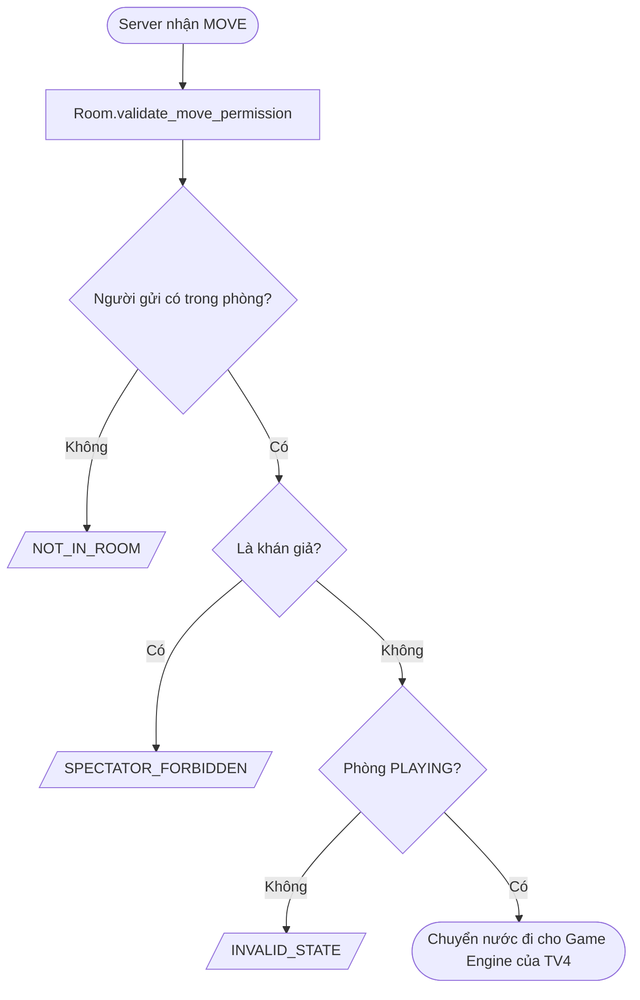

# Phân tích Room & Match – Game Caro trực tuyến (UDM_16)

- **Người phụ trách:** TV3 – Room & Match
- **Giai đoạn:** 1 – Phân tích yêu cầu và thiết kế hệ thống
- **Sản phẩm bàn giao:** Sơ đồ hoạt động Room & Match

---

## 1. Phạm vi

Module Room & Match chịu trách nhiệm quản lý phòng đấu trên Server:

- Tạo phòng, tham gia phòng, rời phòng.
- Danh sách phòng (kể cả danh sách trận đang diễn ra để khán giả vào xem).
- Phân chia quân X/O.
- Quản lý vai trò người chơi / khán giả.
- Quản lý trạng thái phòng.

Module **không** đảm nhiệm: truyền nhận socket (TV1), đăng nhập (TV2), luật chơi và kiểm tra thắng thua (TV4), đồng bộ bàn cờ (TV5), giao diện (TV6).

## 2. Yêu cầu từ đề bài

| Yêu cầu đề bài | Cách module Room & Match đáp ứng |
|---|---|
| Server hỗ trợ nhiều trận đấu đồng thời, quản lý trạng thái riêng từng phòng | `RoomManager` giữ nhiều đối tượng `Room` độc lập, có khóa luồng |
| Xem danh sách trận đang diễn ra, tham gia với vai trò khán giả | `list_rooms(only_playing=True)` và `join_as_spectator` |
| Khán giả vào giữa trận được nhận đủ trạng thái hiện tại | Room báo có khán giả mới, TV5 gửi toàn bộ trạng thái bàn cờ |
| Server phân biệt người chơi và khán giả; khán giả không được đánh | `role_of()`, `can_move()`, `validate_move_permission()` |
| Khán giả rời phòng không ảnh hưởng trận | `leave_room` chỉ xóa khỏi danh sách khán giả |

## 3. Tác nhân và use case

| Tác nhân | Use case |
|---|---|
| Chủ phòng (quân X) | Tạo phòng, bắt đầu trận, rời phòng, chơi lại |
| Người chơi thứ hai (quân O) | Xem danh sách phòng, vào phòng chơi, rời phòng |
| Khán giả | Xem danh sách trận đang diễn ra, vào xem, rời phòng |
| Server | Quản lý nhiều phòng, phân vai, chặn thao tác không hợp lệ |

## 4. Quy tắc nghiệp vụ

1. Mỗi người chỉ ở **một phòng** tại một thời điểm.
2. Mỗi phòng có tối đa **2 người chơi** (X và O); số khán giả không giới hạn.
3. Chủ phòng cầm quân X, người vào chơi sau cầm quân O. Nếu người cầm X rời phòng khi chưa đấu, người vào sau nhận **vai còn trống** (không ghi đè người đang có trong phòng).
4. Chỉ vào chơi được khi phòng ở trạng thái `WAITING`. Vào xem được ở mọi trạng thái, kể cả giữa trận.
5. Chỉ chủ phòng được bắt đầu trận, và phòng phải đủ 2 người chơi.
6. Khán giả không được gửi nước đi; Server từ chối.
7. Khán giả rời phòng không ảnh hưởng đến trận đấu.
8. Người chơi rời phòng giữa trận: trận bị hủy, người còn lại thắng do đối phương rời trận (`leave_room` trả `match_aborted=True` và `winner`; **cần thống nhất với TV4, TV5**). Phòng quay về `WAITING` để người khác vào chơi, không bị kẹt.
9. Chủ phòng rời khi phòng còn người chơi: quyền chủ phòng chuyển cho người còn lại. Không còn người chơi: phòng đóng.
10. Sau khi trận kết thúc, có thể chơi lại và đổi quân X/O.
11. Các phòng độc lập, thao tác ở phòng này không ảnh hưởng phòng khác.

## 5. Vai trò trong phòng

| Vai trò | Giá trị | Được đánh cờ | Nhận cập nhật bàn cờ |
|---|---|---|---|
| Người chơi X | `X` | Có (đúng lượt) | Có |
| Người chơi O | `O` | Có (đúng lượt) | Có |
| Khán giả | `SPECTATOR` | Không | Có |

## 6. Trạng thái phòng

| Trạng thái | Ý nghĩa |
|---|---|
| `WAITING` | Có chủ phòng, đang chờ người chơi thứ hai |
| `READY` | Đủ 2 người chơi, chưa bắt đầu |
| `PLAYING` | Trận đang diễn ra |
| `FINISHED` | Trận kết thúc (thắng/thua/hòa/hết giờ); đủ 2 người thì có thể chơi lại |
| `CLOSED` | Phòng đã đóng, bị xóa khỏi hệ thống |

## 7. Sơ đồ hoạt động

### 7.1 Tạo phòng

### 7.2 Vào phòng (chơi hoặc xem)

### 7.3 Rời phòng

### 7.4 Bắt đầu trận

### 7.5 Chặn khán giả đánh cờ

## 8. Tình huống ngoại lệ

| Tình huống | Server xử lý | Mã lỗi |
|---|---|---|
| Vào phòng không tồn tại | Từ chối | `ROOM_NOT_FOUND` |
| Vào chơi khi phòng đã đủ 2 người | Từ chối, gợi ý vào xem | `ROOM_FULL` |
| Đang trong phòng mà vào phòng khác | Từ chối | `ALREADY_IN_ROOM` |
| Rời phòng khi không ở phòng nào | Từ chối | `NOT_IN_ROOM` |
| Người không phải chủ phòng bấm bắt đầu | Từ chối | `NOT_HOST` |
| Bắt đầu khi chưa đủ 2 người | Từ chối | `INVALID_STATE` |
| Khán giả gửi nước đi | Từ chối | `SPECTATOR_FORBIDDEN` |
| Người chơi mất kết nối giữa trận | Xử lý như rời phòng (chi tiết phối hợp TV1, TV5) | – |
| `username` rỗng/không phải chuỗi, `time_limit` ngoài 5–600 giây | Từ chối | `INVALID_ARGUMENT` |
| Hai người cùng vào ô chơi cuối cùng | Một người thành công nhờ khóa luồng | `ROOM_FULL` |

## 9. Điểm giao tiếp cần thống nhất với các thành viên

| Với | Nội dung cần thống nhất | Trạng thái |
|---|---|---|
| TV1 | Định dạng message, tên lệnh (`CREATE_ROOM`, `JOIN_ROOM`, `LEAVE_ROOM`, `LIST_ROOMS`, `START_MATCH`), bảng mã lỗi | Chưa chốt |
| TV2 | Định danh người chơi dùng `username` hay `player_id` | Chưa chốt |
| TV4 | Người chơi rời giữa trận ghi là "đối thủ thắng" hay "hủy trận"; ai gọi `finish_match` | Chưa chốt |
| TV5 | Khi khán giả vào giữa trận, TV5 gửi full trạng thái; TV3 chỉ báo có khán giả mới | Chưa chốt |
| TV6 | Dữ liệu hiển thị Room List và thông tin phòng (`to_summary`, `to_dict`) | Chưa chốt |

## 10. Sản phẩm bàn giao giai đoạn 1

- [ ] Tài liệu này (`phan_tich_room_match.md`)
- [ ] Ảnh sơ đồ trạng thái phòng
- [ ] Ảnh các sơ đồ hoạt động (tạo phòng, vào phòng, rời phòng, bắt đầu trận, chặn khán giả)
- [ ] File nguồn sơ đồ (`.mmd` hoặc `.drawio`)
- [ ] Các điểm ở mục 9 đã được thống nhất với nhóm
